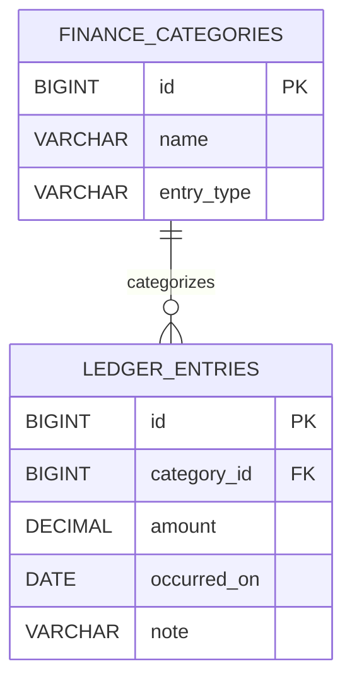

# 个人记账与分类统计系统报告

## 1. 项目目标与完成情况

本模块在现有 Spring Boot 3、MyBatis-Plus 和 MySQL 项目中，增加了可直接使用的个人账本页面，用于记录收入与支出、按日期和分类查询账目，并查看分类汇总。

| 验收项 | 完成内容 |
| --- | --- |
| 用户页面 | `/finance.html`：新增、查看、编辑、删除账目；日期、收支类型和分类筛选；分页；收入、支出、结余及分类统计 |
| 数据表 | 新增 `finance_categories` 和 `ledger_entries` 两张记账模块业务表，内置 4 个收入分类和 5 个支出分类 |
| REST 接口 | 6 个：账目新增、分页查询、详情、修改、删除、日期区间汇总 |
| 自动化测试 | 新增 11 个记账集成测试；全项目 `mvn clean verify` 共 39 项测试通过 |
| 文档 | 更新项目 README，补充本报告、数据结构、接口、校验、运行和 SQL 审查说明 |

从任务清单页点击“账目与分类统计”可进入账本，也可在应用启动后直接访问 <http://localhost:8080/finance.html>。页面只提供记账操作与结果，不展示后端类名或调试路由。

## 2. 模块结构与调用链

新增代码位于 `com.eightsnpc.todo.finance` 及配套 API、持久化和服务包：

```text
finance.html / finance.js
        ↓ HTTP JSON
LedgerController → LedgerEntryRequest / LedgerEntryResponse
        ↓
FinanceService → DatabaseFinanceService
        ↓
LedgerEntryMapper / FinanceCategoryMapper → MyBatis-Plus → MySQL
```

Controller 负责 HTTP 参数接收、DTO 校验和统一响应封装；Service 处理金额、日期范围、分类一致性及汇总规则；Mapper 负责参数化条件查询和数据库聚合。API 成功与失败响应沿用项目现有 `{ success, data, error }` 结构。

## 3. 数据表设计

账目金额使用 `DECIMAL(12,2)`，避免浮点误差。一个分类可以关联多笔账目；分类删除由外键限制，防止已有账目失去分类。



| 表 | 关键字段与约束 |
| --- | --- |
| `finance_categories` | 固定分类 ID、名称、`INCOME`/`EXPENSE` 类型；类型与名称联合唯一；类型有 CHECK 约束 |
| `ledger_entries` | 自增 ID、非空分类外键、正数金额、发生日期、可空备注；金额有 CHECK 约束；删除账目不影响分类 |

收入分类：工资、红包、其他，并扩展奖金、兼职；支出分类：饮食、生活缴费、娱乐、网络应用、其他，并扩展交通、住房、购物、日用。已有分类 ID 保持稳定，调整名称时账目仍关联原分类 ID。

索引包括 `ledger_entries(occurred_on, id)` 支持日期范围和稳定排序，`ledger_entries(category_id, occurred_on, id)` 支持分类与日期组合查询；外键列也包含在复合索引前缀中。分类数据在 `src/main/resources/db/init.sql` 初始化，脚本重复执行时不会重复插入分类。测试使用独立 H2 MySQL 兼容模式和 `src/test/resources/schema.sql`。

## 4. REST API

所有接口都返回统一 JSON 包装。下表路径均以 `/api/v1/ledger` 为前缀：

| 序号 | 方法与路径 | 用途 |
| ---: | --- | --- |
| 1 | `POST /entries` | 创建账目，成功返回 201 和账目详情 |
| 2 | `GET /entries` | 分页查询，支持 `page`、`size`、`from`、`to`、`categoryId`、`type` |
| 3 | `GET /entries/{id}` | 查询单笔账目 |
| 4 | `PUT /entries/{id}` | 修改分类、金额、日期和备注 |
| 5 | `DELETE /entries/{id}` | 删除账目 |
| 6 | `GET /summary` | 按 `from`、`to` 汇总收入、支出、结余及各分类金额与笔数 |

分类选项随汇总接口的 `categories` 数组返回，其中包含零金额分类；因此记账模块无需增加第七个分类查询接口。`type` 查询值为 `INCOME` 或 `EXPENSE`，分页 `size` 范围为 1–100。

新增/修改请求示例：

```json
{
  "categoryId": 5,
  "amount": 35.80,
  "occurredOn": "2026-11-09",
  "note": "午餐"
}
```

列表筛选示例：`GET /api/v1/ledger/entries?page=1&size=10&from=2026-11-01&to=2026-11-30&type=EXPENSE`。

## 5. 业务规则与错误处理

- 金额必须大于 0，最多 10 位整数和 2 位小数；Java DTO 校验和 Service 校验共同保护写入规则。
- 分类必须存在；查询类型与分类类型同时传入时，两者必须一致。
- 日期查询支持只给开始日期、只给结束日期或两者都给；开始日期晚于结束日期时返回 400。
- 账目按发生日期倒序，再按 ID 倒序排列，分页结果稳定。
- 汇总使用数据库 `SUM` 和 `COUNT` 分组计算，日期边界包含当天；结余 = 收入合计 − 支出合计。
- 当前日期范围没有账目时，收入/支出/结余卡片和分类统计区都会隐藏；有账目时分类统计区只展示有金额的分类。记账表单和筛选器仍保留全部分类供选择。
- 请求字段和参数错误使用 HTTP 400 与 `BAD_REQUEST`；不存在的账目使用 HTTP 404 与 `LEDGER_ENTRY_NOT_FOUND`。

## 6. 测试与验证

新增 `FinanceApiIntegrationTest` 共 11 个测试方法，覆盖创建、带筛选分页、详情、修改、删除、分类汇总、指定分类可用性、金额校验、无效分类、日期范围/格式错误和账目不存在。全项目执行：

```powershell
$env:JAVA_HOME = 'D:\后端软件\jdk-21\jdk-21.0.13+9'
$env:Path = "$env:JAVA_HOME\bin;D:\后端软件\apache-maven-3.10.0\bin;$env:Path"
mvn clean verify
```

验证结果：**BUILD SUCCESS，39 tests run，0 failures，0 errors，0 skipped**。Finance 自动化测试由 H2 内存库运行，不会写入本机 MySQL 数据库。

另在独立临时 MySQL 8.4 数据库上做过冒烟检查：空库启动时成功创建两张记账表和分类种子；账本页面以 UTF-8 返回 HTTP 200；创建、读取、修改、删除以及日期范围汇总均成功，收入 3000.00、支出 35.80 的汇总值符合预期。用户反馈分类为空后，检查发现实际 `task_api` 尚无记账表；重启项目后已在该数据库创建记账表并初始化 14 个分类。汇总接口已确认包含用户指定的收支分类，账目列表为空；原有任务、项目和评论表未清空。

## 7. SQL 审查记录

按照项目采用的 `sql-code-review` 检查 schema 与查询：

1. DDL 为固定语句，分类、日期和金额来自 JSON DTO，并经过校验；MyBatis-Plus 条件构造器和 `@Param` 使用绑定参数，没有把用户输入拼接到 SQL 文本。
2. 金额采用定点数；正数和收支类型有数据库 CHECK 约束；分类外键为非空且 `ON DELETE RESTRICT`。
3. 日期与分类日期查询有对应 B-tree 复合索引，唯一索引限制同一收支类型下的重复分类名称。
4. 汇总查询从分类表左连接账目，使无交易分类也返回 0 金额；时间条件放在连接条件中，不会把左连接退化成仅返回有账目的内连接结果。
5. `CREATE TABLE IF NOT EXISTS` 可在已有数据库上新增缺失表，不会清空其他模块数据。它不是版本迁移工具；将来调整已存在列或约束时应增加迁移脚本。

## 8. 当前范围

收入和支出分类由初始化 SQL 提供固定种子数据，当前不支持用户自定义分类；模块面向单用户本地练习，不含登录、多账户、预算、导出或多币种能力。这些不影响本次表格要求的账目 CRUD、收支分类、日期查询和基础统计。
